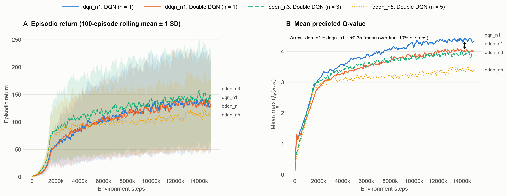
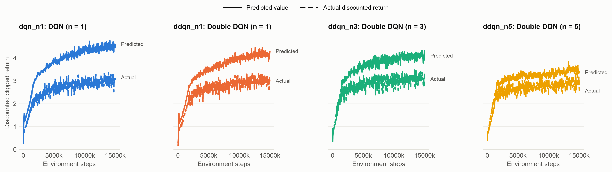

# Results: 15 million steps per run

The four variants trained on Atari Breakout from RAM for 15 million steps each, with 5 seeds per
variant: 20 runs in all. Every run finished.

## Summary

- **`ddqn_n3` played best and most consistently.** It averaged 149 points per game at the end,
  with all 5 seeds between 143 and 155.
- **`ddqn_n5` learned fastest early, then fell behind.** It kept pace with `ddqn_n3` up to about
  2 million steps, then improved much more slowly and finished last, at 112.
- **Double DQN didn't change the score.** `ddqn_n1` (129) and `dqn_n1` (131) stayed within a few
  points of each other throughout training.
- **Double DQN did reduce overestimation.** It predicted lower values than DQN, and the gap between
  its predicted values and the returns it actually earned was smaller.
- **Every variant overestimated its values,** and the gap shrank as n grew.
- **No agent won the game.** The best single games scored 385 to 421 points across all runs.

These are observed differences between 5 seeds per variant, not results of significance tests.

## Results

Final score is the mean raw game score over each run's last 100 games, averaged over 5 seeds. The
value gap is the predicted value minus the discounted return actually earned, averaged over each
run's last 20 evaluations.

| Variant | Algorithm | Final score | Range across seeds | Best single game | Value gap |
|---|---|---|---|---|---|
| `dqn_n1` | DQN, n = 1 | 131 | 105 to 149 | 414 | 1.49 |
| `ddqn_n1` | Double DQN, n = 1 | 129 | 115 to 147 | 421 | 1.16 |
| `ddqn_n3` | Double DQN, n = 3 | **149** | 143 to 155 | 419 | 1.02 |
| `ddqn_n5` | Double DQN, n = 5 | 112 | 95 to 121 | 411 | 0.50 |

### Score over training

Mean score over the last 100 games played by each point, averaged over 5 seeds:

| Variant | 1M | 2M | 3M | 5M | 10M | 15M |
|---|---|---|---|---|---|---|
| `dqn_n1` | 11 | 56 | 72 | 99 | 118 | 131 |
| `ddqn_n1` | 11 | 57 | 72 | 99 | 118 | 129 |
| `ddqn_n3` | 21 | 83 | 105 | 115 | 142 | 149 |
| `ddqn_n5` | 21 | 77 | 90 | 97 | 103 | 112 |

In panel A, the shaded band is one standard deviation of single-game scores, which vary widely from
game to game, so the lines carry the comparison.

### Predicted values against actual returns

Values are in units of discounted clipped return until the next lost life, not game points. Each is
the mean over a run's last 20 evaluations, averaged over 5 seeds.

| Variant | Predicted value | Actual return | Gap | Mean predicted Q in training |
|---|---|---|---|---|
| `dqn_n1` | 4.52 | 3.03 | 1.49 | 4.32 |
| `ddqn_n1` | 4.13 | 2.97 | 1.16 | 3.98 |
| `ddqn_n3` | 4.10 | 3.09 | 1.02 | 3.95 |
| `ddqn_n5` | 3.43 | 2.93 | 0.50 | 3.40 |

## Interpretation

- **Double Q-learning (`dqn_n1` against `ddqn_n1`):** the actual returns are almost the same (3.03
  and 2.97), while Double DQN's predictions are lower (4.13 against 4.52). That is a direct sign of
  reduced overestimation, not just of a different policy. The reduction didn't lead to better play.
- **n-step returns (`ddqn_n1`, `ddqn_n3`, `ddqn_n5`):** n = 3 improved both speed and final score
  over n = 1. n = 5 helped early but hurt later. That fits the uncorrected off-policy bias of longer
  n-step returns described in [`EXPERIMENTS.md`](../EXPERIMENTS.md) section 8, but these runs can't
  show it's the cause.
- **`ddqn_n5`'s small value gap** comes with lower predicted values and weaker play, so it shouldn't
  be read as the most accurate value estimate on its own.
- **Overestimation grew with training.** In the earlier 500,000-step study the gap was about 0.1 to
  0.3; here it is 0.5 to 1.5.
- **Winning:** the best games, 385 to 421 points, come close to clearing the first wall of bricks.
  No run cleared both walls, which is what winning takes.

## Setup

| Setting | Value |
|---|---|
| Steps per run | 15,000,000 (4 emulator frames each) |
| Seeds | 1 to 5 for each variant |
| Learning rate | 0.0001 (Adam) |
| Batch size | 64 |
| Replay buffer | 100,000 transitions |
| Discount γ | 0.99 |
| Target network τ | 0.005, after every update |
| Exploration | ε from 1.0 to 0.05 over the first 1,500,000 steps (10%), then fixed |
| Learning starts | 10,000 steps, then one update every 4 steps |
| Loss | Huber, δ = 1.0 |
| Evaluation | 5 games at ε = 0.01 every 25,000 steps: 600 evaluations per run |
| Training heuristics | Clipped rewards, lost life ends the target, automatic FIRE |
| Snapshots | Seed 1 of each variant, every 2,000,000 steps |
| Device | CPU, MacBook Air M4, 4 runs at a time |
| W&B | Offline |
| Code | Commit `283f62c`, run with `make study STEPS=15000000` |

Apart from the run length, these are the settings frozen by the pilot in
[`EXPERIMENTS.md`](../EXPERIMENTS.md) section 5. Exploration decays over 10% of the run, so it took
1.5 million steps here. Early scores are therefore much lower than in the 500,000-step study, and
the two studies can't be compared step for step.

## Checks

| Check | Result |
|---|---|
| Runs finished | 20 of 20, with no errors, warnings or crashes in any run log |
| Steps reached | 15,000,000 in every run |
| Training rows per run | 37,475, as expected for 3,747,500 updates averaged in groups of 100 |
| Evaluations per run | 600, every 25,000 steps |
| NaN or infinite values | None, in the metrics or the saved models |
| Settings | Identical across all 20 runs |

## Training time

The study ran from 12:16 on 4 November 2026 to 03:40 on 5 November 2026: 15 hours 25 minutes,
for 61.5 hours of training across the 20 runs.

| Variant | Mean time per run | Range |
|---|---|---|
| `dqn_n1` | 3.16 hours | 2.99 to 3.22 |
| `ddqn_n1` | 3.10 hours | 3.02 to 3.21 |
| `ddqn_n3` | 3.14 hours | 3.07 to 3.25 |
| `ddqn_n5` | 2.90 hours | 2.85 to 3.04 |

## Files

The results are in `logs/steps_15000000/`, which Git ignores, so keep a copy if you need them.

| Output | Location |
|---|---|
| Metrics | `csv/{variant}_seed{seed}_metrics.csv` |
| Final models | `checkpoints/{variant}_seed{seed}.pt` |
| Snapshots, seed 1 | `checkpoints/{variant}_seed1/step_{step}.pt`, at 0, 2M, 4M and so on to 14M |
| Videos, seed 1 | `videos/{variant}_seed1/`: 9 per variant, one per snapshot plus `final.mp4` |
| Run logs and timings | `run_logs/` |
| Figures | `figures/`, copied to `docs/figures/steps_15000000/` |

Each video is one game, so scores vary from clip to clip. Use them to see how play changes, and the
tables above to compare variants.
